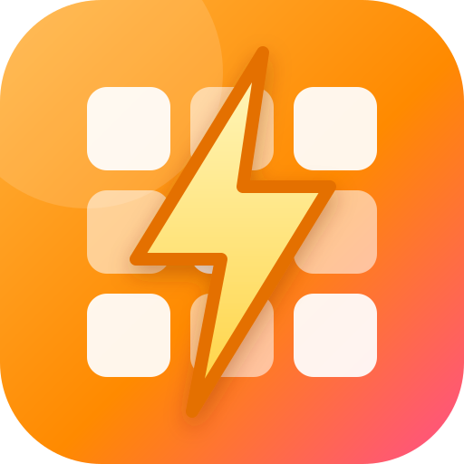

<p align="center">
  
</p>

<h1 align="center">合併島嶼矩陣閃電計算器</h1>

<p align="center">
  合併島嶼（Merge Island）的閃電需求計算工具 · 大佬群CSL製作
</p>

---

## 功能

- **目標合併值**：可選 11、12、13 個，或自行輸入（1–25）。
- **拖拉式 7 × 7 矩陣**：把棋盤上的物件拖曳或點選放進矩陣，對照遊戲中的實際盤面。
- **即時計算**：自動顯示目前矩陣折算值、還缺多少閃電，以及完成度。
- **多語系**：中文、English、Tiếng Việt、日本語、한국어、ไทย、Bahasa Indonesia、Español、Português。
- **行動裝置友善**：支援觸控拖曳，可加入主畫面當作 App 使用。
- **攻略小幫手**：右下角的圓形按鈕打開合併攻略，內容會依語言和活動切換。
- **活動切換**：標題下方可切換「合併島嶼」、「盆栽基地」與「遊戲中心」；合併計算器是共用的，切換活動不會清掉矩陣。

## 活動

| 活動 | 網址 | 額外工具 |
| --- | --- | --- |
| 合併島嶼 | `#island`（預設） | 無，只有合併計算器 |
| 盆栽基地 | `#bonsai` | 盆栽閃擊賽（24 關）與合併搭檔魚兒進度條（16 關）的獎勵一覽：每關獎勵（SVG 繪製）、需求與累計數量 |
| 遊戲中心 | `#game-center` | 遊戲狂熱（24 關）獎勵一覽，以及遊戲區兌換（4 個兌換台 × 4 項，用方塊代幣依序兌換） |

## 計算方式

每個物件等級對應 2 的次方：Lv.1 = 1、Lv.2 = 2、Lv.3 = 4 …… Lv.n = 2<sup>n-1</sup>。

選擇目標合併值 N 時，目標需求為 2<sup>N</sup>，可拖拉的物件為 Lv.1 到 Lv.(N-1)。
矩陣中所有物件的值加總後，與目標需求的差額就是還需要補的閃電數。

## 使用方式

頁面會透過 `fetch` 載入語系與活動資料（JSON），因此需要經由 HTTP 開啟（直接雙擊 `index.html` 會因瀏覽器限制而無法載入語系）。

```bash
npx serve .
```

或使用 Python：

```bash
python -m http.server 8000
```

然後開啟 <http://localhost:8000>。也可以直接部署到 GitHub Pages 等靜態網站服務。

## 檔案結構

| 檔案 | 說明 |
| --- | --- |
| `index.html` | 頁面外殼：標題、活動切換、計算器、攻略 |
| `css/style.css` | 全站樣式 |
| `js/merge-core.js` | 合併計算器與攻略（所有活動共用），並提供 `window.MergeCore` 給活動模組使用 |
| `js/app.js` | 依網址 `#活動` 載入對應的活動模組 |
| `js/events/reward-kit.js` | 各活動共用：獎勵圖示（SVG）、獎勵名稱、關卡格子 |
| `js/events/bonsai.js` | 盆栽基地的獎勵一覽 |
| `js/events/game-center.js` | 遊戲中心的獎勵一覽與兌換台 |
| `data/events/bonsai.json` | 盆栽基地各關卡需求與獎勵（每關的需求，不是累計） |
| `i18n/core.json` | 共用文字（9 種語言） |
| `i18n/events/bonsai.json` | 盆栽基地文字與攻略（9 種語言） |
| `data/events/game-center.json` | 遊戲中心關卡與兌換台資料 |
| `i18n/events/game-center.json` | 遊戲中心文字與攻略（9 種語言） |
| `icon.svg` | App icon / favicon |
| `manifest.webmanifest` | PWA 設定，讓網頁可加入主畫面 |

## 新增活動

1. 在 `js/events/` 新增模組，匯出 `mount(slot, core)`，回傳卸載函式。
2. 把關卡資料放在 `data/events/<活動>.json`，文字與攻略放在 `i18n/events/<活動>.json`。
3. 在 `js/app.js` 的 `EVENTS` 加一筆，並在 `index.html` 的活動切換列加上連結，`i18n/core.json` 加上活動名稱。

活動模組只在計算器下方加自己的工具，並可用 `core.setGuideExtra()` 在攻略前面加入活動專屬段落；不要修改矩陣或它的狀態。
