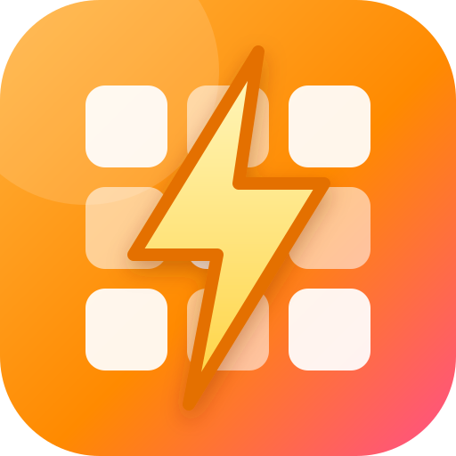

<p align="center">
  
</p>

<h1 align="center">合併島嶼矩陣閃電計算器</h1>

<p align="center">
  合併島嶼（Merge Island）的閃電需求計算工具 · 由 Coin999 - 長長久久 隊伍製作
</p>

---

## 功能

- **目標合併值**：可選 11、12、13 個，或自行輸入（1–25）。
- **拖拉式 7 × 7 矩陣**：把棋盤上的物件拖曳或點選放進矩陣，對照遊戲中的實際盤面。
- **即時計算**：自動顯示目前矩陣折算值、還缺多少閃電，以及完成度。
- **多語系**：中文、English、Tiếng Việt、日本語、한국어、ไทย、Bahasa Indonesia、Español、Português。
- **行動裝置友善**：支援觸控拖曳，可加入主畫面當作 App 使用。

## 計算方式

每個物件等級對應 2 的次方：Lv.1 = 1、Lv.2 = 2、Lv.3 = 4 …… Lv.n = 2<sup>n-1</sup>。

選擇目標合併值 N 時，目標需求為 2<sup>N</sup>，可拖拉的物件為 Lv.1 到 Lv.(N-1)。
矩陣中所有物件的值加總後，與目標需求的差額就是還需要補的閃電數。

## 使用方式

頁面會透過 `fetch` 載入 `i18n.json`，因此需要經由 HTTP 開啟（直接雙擊 `index.html` 會因瀏覽器限制而無法載入語系）。

```bash
npx serve .
```

或使用 Python：

```bash
python -m http.server 8000
```

然後開啟 <http://localhost:8000>。也可以直接部署到 GitHub Pages 等靜態網站服務。

## 檔案結構

| 檔案 | 說明 |
| --- | --- |
| `index.html` | 主頁面（HTML、CSS、JavaScript 皆在同一個檔案） |
| `i18n.json` | 各語系文字 |
| `icon.svg` | App icon / favicon |
| `manifest.webmanifest` | PWA 設定，讓網頁可加入主畫面 |
